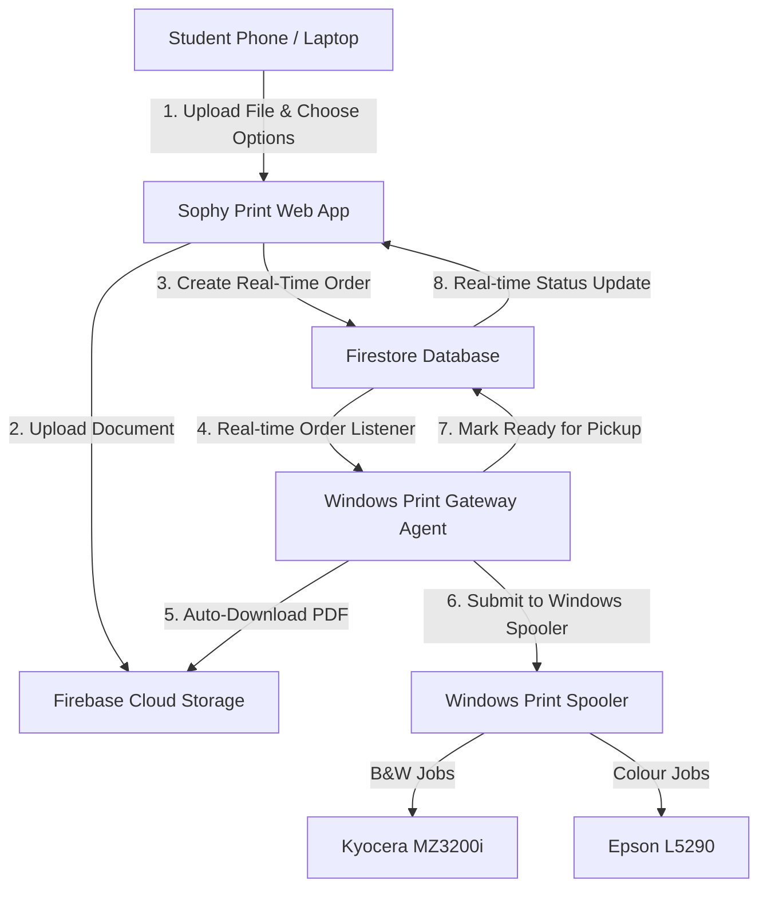

# Sophy Print — College Smart Print System

Welcome to **Sophy Print**, a full-stack, cloud-connected autonomous printing platform designed for campus copy centers and xerox shops.

The entire process is automated:
1. **Students** upload their documents from their phone or laptop, configure settings, and receive a secure pickup code.
2. **Firebase** securely stores the file and manages the live queue in Firestore.
3. **Windows Print Gateway Agent** running on the shop's computer listens to the queue, downloads the files, and routes them directly to the physical printers without staff intervention.
4. **Physical Printers** (Kyocera MZ3200i for High-Speed B&W, Epson L5290 for Precision Colour) execute the print jobs automatically.

---

## 🔐 Admin Dashboard Access

The administrative dashboard provides full control over live queues, machine telemetry, cost-saving storage management, and revenue analytics.

- **Admin Login Portal URL:** `/admin`
- **Admin Email:** `Sophyra18@gmail.com`
- **Admin Password:** `181818`

> **Note on Authentication:** Authentication is handled securely via Firebase Authentication. On first login, if the account does not yet exist in your Firebase project, the system automatically registers the credentials and provisions admin rights.

---

## 🏗️ System Architecture & Workflow



### Complete End-to-End Steps:
1. **Document Validation**: Student selects a document. The client validates the file format (accepts `.pdf`, `.docx`, `.doc`, `.pptx`, `.ppt` and rejects non-printable formats such as `.mp3`, `.mp4`, `.zip`, `.exe`).
2. **Page Count & Pricing**: The web app inspects the PDF structure client-side, calculates exact page count, applies single/double-sided options, and computes total cost.
3. **Secure Cloud Sync**: Files are placed in Firebase Cloud Storage, and order metadata is written to the `orders` Firestore collection.
4. **Autonomous Windows Agent**: The shop's computer runs the background agent (`print-agent/`). It detects newly paid orders, downloads the PDF to a temporary folder, and dispatches the file to the configured Windows printer driver via PowerShell spooler commands.
5. **Collection**: Student presents their 4-character pickup code at the counter to collect the printed papers.

---

## 🛠️ Technology Stack

- **Frontend & App Framework**: [TanStack Start](https://tanstack.com/start) + [React 19](https://react.dev) + [Vite](https://vitejs.dev)
- **Styling**: Vanilla Tailwind CSS with high-contrast light theme and accessible typography.
- **Backend & Cloud Database**: Firebase Firestore (real-time collections for `orders`, `gateways`, and `pricing`).
- **File Storage**: Firebase Cloud Storage with automated lifecycle & date-range purge capabilities.
- **Print Daemon**: Node.js Windows Background Agent (`print-agent/agent.js`) integrating with native Windows Print Spooler (`PrintTo`).
- **Testing**: [Vitest](https://vitest.dev) test suite covering routing, file validation, and order management.

---

## 🚀 Setup & Local Development Guide

### Prerequisites
- **Node.js**: v18.0.0 or later (LTS recommended)
- **npm**: v9.0.0 or later
- **Operating System**: Windows 10/11 x64 (for the Print Agent) or any OS (for the Web App)

---

### Step 1: Install Dependencies
Open your terminal in the project root directory and run:

```bash
npm install
```

### Step 2: Start the Development Web Server
Start the local development server:

```bash
npm run dev
```

Open your browser and visit:
- **Student Portal**: [http://localhost:3000](http://localhost:3000)
- **Order Tracker**: [http://localhost:3000/track](http://localhost:3000/track)
- **Admin Dashboard**: [http://localhost:3000/admin](http://localhost:3000/admin)

### Step 3: Run Verification Tests
To verify all routes, business logic, and security assertions:

```bash
npm run test
```

---

## 🖨️ Windows Print Gateway Setup Guide

The Print Gateway is a lightweight background service that runs on the shop computer connected to your printers.

### Directory: `print-agent/`

Inside `print-agent/` you will find:
- `agent.js`: The core background service listening to Firebase Firestore.
- `config.json`: Configuration specifying Firebase keys, gateway ID, and printer driver names.
- `start-agent.bat`: 1-click batch launcher for shop staff.
- `package.json`: Dependencies for the agent (`firebase`).

### How to Run the Print Agent on the Shop PC:

1. **Install Node.js on the shop PC** from [https://nodejs.org/](https://nodejs.org/).
2. **Verify Printer Names** in Windows:
   - Open **Settings > Bluetooth & devices > Printers & scanners**.
   - Note the exact names of your printers (e.g. `Kyocera MZ3200i` and `Epson L5290`).
3. **Check `print-agent/config.json`**:
   Ensure the printer names match your Windows printer names:
   ```json
   {
     "gatewayId": "SHOP-PC-01",
     "shopName": "Campus Xerox & Print Center",
     "printers": {
       "bw": "Kyocera MZ3200i",
       "colour": "Epson L5290"
     },
     "pollIntervalSeconds": 3,
     "heartbeatIntervalSeconds": 15
   }
   ```
4. **Launch the Agent**:
   Double-click `start-agent.bat` (or open command prompt and run `node agent.js`).
   - The agent will check and install dependencies automatically.
   - It sends a live heartbeat to Firestore every 15 seconds.
   - It begins listening for incoming orders and sends them directly to the printer spooler.

---

## ❓ Frequently Asked Questions

### What is the "Gateway Pair Code"?
In early prototypes, a placeholder "Pair Code" was shown in mock UI. **In the production system, no pair code is needed.** The agent connects securely and directly to the Firebase Cloud instance using the authenticated credentials in `config.json`. The web admin dashboard automatically discovers the agent via its real-time heartbeat in the `gateways` Firestore collection.

### How does the Storage Purge feature work?
Firebase Cloud Storage incurs charges if gigabytes of old student PDFs accumulate. The **Admin Storage Manager** (`/admin/storage`) lets operators select a date range (e.g. older than 7 days, 30 days, or custom) and delete files permanently from Firebase Storage with one click while keeping historical revenue records intact.

---

## 📁 Repository Structure

```
├── print-agent/                 # Windows background print agent
│   ├── agent.js                 # Print daemon & spooler bridge
│   ├── config.json              # Firebase & printer configuration
│   ├── start-agent.bat          # 1-click launcher for Windows
│   └── package.json             # Agent dependencies
├── src/
│   ├── components/              # Reusable UI components & admin shell
│   │   ├── admin-login.tsx      # Secure Firebase Auth login form
│   │   ├── admin-shell.tsx      # Responsive admin layout with live revenue
│   │   └── ui/                  # Accessible UI primitives
│   ├── lib/
│   │   ├── admin-auth.ts        # Admin authentication state & provider
│   │   ├── firebase.ts          # Firebase SDK initialization
│   │   └── print-data.ts        # Business logic, Firestore hooks & storage purger
│   ├── routes/                  # TanStack Router routes
│   │   ├── index.tsx            # Student upload & order creation portal
│   │   ├── track.tsx            # Live order tracker with pickup code
│   │   ├── admin.index.tsx      # Admin metrics & daily overview
│   │   ├── admin.queue.tsx      # Live interactive print queue
│   │   ├── admin.storage.tsx    # Firebase Storage cost-saving manager
│   │   ├── admin.machines.tsx   # Machine health & gateway telemetry
│   │   ├── admin.orders.tsx     # Order history with search & export
│   │   ├── admin.pricing.tsx    # Pricing rules editor
│   │   └── admin.revenue.tsx    # Detailed revenue breakdown
│   └── test/                    # Automated Vitest test suite
└── README.md                    # This documentation file
```
